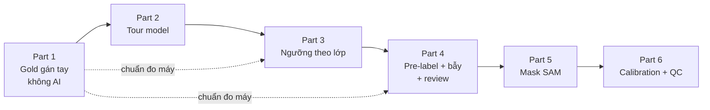

# Hướng dẫn làm lab (từng Part)

Bài **cá nhân, 4 giờ trên lớp** (+ ~45 phút cài đặt **làm trước buổi học**). Lệnh chạy **từ thư mục gốc repo**, venv đã kích hoạt.
Luật chơi: [RULES.md](RULES.md) · Chấm điểm: [RUBRIC.md](RUBRIC.md) · Nộp bài: [SUBMISSION.md](SUBMISSION.md) · Mốc tự kiểm: [CHECKPOINTS.md](CHECKPOINTS.md).

```
TRƯỚC LỚP  Part 0  Cài đặt + tải 3 model + Project CVAT     ~45'   (không tính giờ)
TRÊN LỚP   Part 1  Gán tay 4 ảnh gold (KHÔNG AI)            25'
           Part 2  Tour 3 model: YOLO26 · YOLOE · SAM       30'
           Part 3  Chọn ngưỡng theo lớp                     10'
           nghỉ                                             10'
           Part 4  Pre-label 24 ảnh + 12 bẫy + review       95'
           Part 5  Mask SAM cho 3 vật                       15'
           Part 6  Calibration + QC + báo cáo               45'
           nộp                                              10'
                                                        ----------
                                                        240'
```

Muốn mở rộng (Grounding DINO, OWLv2, SAM 3, `cvat-cli`, pilot, mask 8 ảnh, gán lại mù)? Xem [docs/ADVANCED.md](docs/ADVANCED.md). **Không bắt buộc.**

## Bức tranh tổng



Ba tập ảnh (`data/split.csv`, 36 ảnh):

| Tập | Số ảnh | Vai trò |
|---|---|---|
| **gold** | 4 | bạn **gán tay từ đầu**, làm chuẩn đo máy. **Không** xem pre-label trước khi gán xong |
| **batch** | 24 | lô thật: pre-label → duyệt → QC |
| `pilot` | 8 | chỉ để **thử model ở Part 2** (không phải làm nhãn); cũng dùng ở bài nâng cao |

## Tóm tắt một trang

| Part | Việc | Lệnh chính | Sản phẩm |
|---|---|---|---|
| 0 | cài đặt (trước lớp) | `pip install`, `download_models.py`, `check_env.py` | repo chạy được |
| 1 | gán tay 4 ảnh gold | `prepare_workdirs.py` + CVAT | `labels/gold_manual.json` |
| 2 | thử YOLO26, YOLOE, SAM | `prelabel.py` | `model_log.csv` (≥ 4 dòng) |
| 3 | ngưỡng theo lớp | `threshold_sweep.py` | `qc/threshold_sweep.*` |
| 4 | review 24 ảnh + bẫy | `inject_traps.py`, `review_stats.py` | `labels/batch_reviewed.json`, `qc/review_stats.*` |
| 5 | mask 3 vật | `sam2_points.py` | `masks/*.jpg` (≥ 3) |
| 6 | calibration + QC + báo cáo | `build_release.py`, `qc_sample.py`, `qc_report.py`, `check_submission.py` | `REPORT.md`, `guideline_v1.1`, `calibration_decisions.csv` |

---

## Part 0 — Cài đặt (TRƯỚC buổi học, ~45 phút)

**Đừng để việc này vào giờ học**: tải model cần mạng và thời gian.

1. **Fork** repo thành repo **public** của bạn (tên: [SUBMISSION.md](SUBMISSION.md)), `git clone`; đặt `git config user.name` và `user.email`.
2. Làm theo [docs/SETUP.md](docs/SETUP.md): venv, `pip install -r requirements.txt`, `python scripts/download_models.py --set core` (3 model, ~0.35 GB).
3. `python scripts/check_env.py` → **SẴN SÀNG**. **Máy yếu / không GPU:** dùng [Google Colab](docs/COLAB.md) để chạy model; trên máy bạn chỉ cần phần nhẹ: `pip install -r requirements-local.txt` (không có torch / ultralytics: `check_env.py` sẽ báo FAIL ở các mục đó, bình thường).
4. Cài **CVAT bằng Docker** ([docs/CVAT_AI.md](docs/CVAT_AI.md) mục 0), rồi tạo **Project** từ `cvat/labels_generated.json` (mục 1) và đọc một lượt [label contract](guideline/guideline_v1.0_label_contract.md).
5. Điền [STUDENT.md](STUDENT.md), đổi dòng tiêu đề `# Day 08 Lab —` trong `README.md`. Commit.

## Part 1 — Gold: gán tay 4 ảnh, không AI (25 phút)

**Vì sao trước tiên:** nếu bạn gán gold sau khi đã thấy nhãn máy, bạn bị "neo" và không đo được thiên kiến. Gold là chuẩn để đo **máy**.

1. `python scripts/prepare_workdirs.py` → Task `gold-manual` từ `work/tasks/gold/` (4 ảnh).
2. **Gán tay** theo guideline v1.0: Rectangle cho mọi `person`, `bicycle`, `motorbike`, `car`, `bus`, `truck`, `three_wheeler`; `ignore_region` cho cụm quá nhỏ / dày. **Không chạy model nào lên 4 ảnh này.**
3. Bấm giờ → `submission/time_log.csv` dòng `gold_manual`. Ca không chắc quy tắc: tick `can_review` và ghi 1 dòng vào mục "Ghi chú" của `REPORT.md` (đó là nguyên liệu calibration).
4. Export COCO 1.0 (không lưu ảnh) → `submission/labels/gold_manual.json`; `python scripts/validate_labels.py --all`. Commit.

## Part 2 — Tour 3 model (30 phút)

Chạy **tay** trên 8 ảnh `pilot` (ảnh không phải gold). Mỗi lần chạy ghi **một dòng** `submission/model_log.csv` (copy từ `work/runs.csv`, điền `what_went_right` / `what_went_wrong` / `decision` **bằng mắt nhìn `viz/`**). Chi tiết: [docs/MODELS.md](docs/MODELS.md).

```bash
# A. YOLO26: detector danh mục cố định; thử hai ngưỡng
python scripts/prelabel.py --model yolo26 --size m --split pilot --conf 0.25 --out work/prelabel/t_y26
python scripts/prelabel.py --model yolo26 --size m --split pilot --conf 0.5  --out work/prelabel/t_y26_c05
# B. YOLOE: gõ chữ tìm tuk-tuk / xích lô / ba gác
python scripts/prelabel.py --model yoloe --classes three_wheeler --split pilot --conf 0.25 --out work/prelabel/t_yoloe
# C. SAM (BẮT BUỘC; chọn SAM 1 / 2.1: đổi --sam): box của YOLO26 -> mask
python scripts/prelabel.py --model yolo26 --size m --classes "person,motorbike,car" --images img_004.jpg img_013.jpg \
    --conf 0.3 --segmenter sam --sam sam2.1_b.pt --out work/prelabel/t_sam
```

**Phải thấy được** (ghi vào `model_log`): YOLO26 gọi tuk-tuk là gì? Đổi ngưỡng thì mất / thừa gì? YOLOE tìm được tuk-tuk nào, sót cái nào, box lỏng chỗ nào? Mask SAM sai ở đâu khi box sai?

Rồi chạy **mọi ảnh** một lần (nguồn cho Part 3, 4; ~15 giây GPU, vài phút CPU):

```bash
python scripts/prelabel.py --model yolo26 --size m --split all --conf 0.05 --out work/prelabel/y26_all --no-viz
python scripts/prelabel.py --model yoloe --classes three_wheeler --split all --conf 0.05 --out work/prelabel/yoloe_all --no-viz
```

**Sản phẩm:** `model_log.csv` (≥ 4 dòng, ≥ 3 model: YOLO26, YOLOE, **SAM**).

## Part 3 — Chọn ngưỡng theo lớp (10 phút)

```bash
python scripts/threshold_sweep.py --pred work/prelabel/y26_all/pre.coco.json work/prelabel/yoloe_all/pre.coco.json \
    --gold submission/labels/gold_manual.json
```

Mở `submission/qc/threshold_sweep.md` và `.png` ([cách đọc](docs/THRESHOLD.md)). Chép chuỗi `--thr "..."` để dùng ở Part 4. Ghi vào `REPORT.md` mục 1 ngưỡng từng lớp và lý do.
**Lớp ít vật** (< 5 vật trong 4 ảnh gold, thường bus / truck / bicycle) **không được chọn ngưỡng riêng**: script để mặc định 0.3 và nói rõ. Đó là kết quả đúng, đừng ép.
**Giới hạn phải nói:** chỉ 4 ảnh gold; bạn chọn và chấm trên cùng dữ liệu, nên precision/recall của máy trên gold là **lạc quan**.

**Sản phẩm:** `qc/threshold_sweep.{csv,md,png}`.

## Part 4 — Pre-label, ảnh bẫy và review (95 phút)

1. Gộp pre-label cho 24 ảnh batch (+ 4 gold, chỉ để đo máy; gold **không** vào CVAT):
   ```bash
   python scripts/merge_prelabels.py work/prelabel/yoloe_all/pre.coco.json work/prelabel/y26_all/pre.coco.json \
       --thr "<chuỗi ngưỡng từ Part 3>" --conf 0.3 --iou 0.6 --split "batch,gold" --out work/prelabel/merged_review/pre.coco.json
   ```
2. **Cài 12 bẫy** (hạt giống = MSHV):
   ```bash
   python scripts/inject_traps.py --pre work/prelabel/merged_review/pre.coco.json --student <MSHV>
   ```
   Ra `pre_traps_import.coco.json` (nạp CVAT), `pre_traps.coco.json` (đầy đủ, dùng cho đo) và `traps_key.json` (**đừng mở**), tất cả trong `submission/prelabel/`.
3. Task `batch-review` từ `work/tasks/review/` (24 ảnh), **Upload annotations → COCO 1.0** → **`pre_traps_import.coco.json`** (chỉ 24 ảnh batch; [CVAT_AI.md](docs/CVAT_AI.md) mục 3). Đếm số box ở ảnh đầu.
4. **Review** theo [checklist 4 bước](docs/REVIEW_CHECKLIST.md) (khoảng 3 phút / ảnh; 6 ảnh dày xe máy là 005, 018, 021, 024, 028, 029: **cụm xe nhỏ < 20 px dùng `ignore_region`, đừng vẽ từng vật**): ẩn nhãn máy, quét ảnh trước → bỏ sót → thừa → sai nhãn → lỏng. Nghỉ mỗi ~10 ảnh. Bấm giờ (`batch_review`). Mở `traps_key.json` **chỉ sau khi** export.
5. Export → `submission/labels/batch_reviewed.json`; `validate_labels.py --all`. Đo:
   ```bash
   python scripts/review_stats.py --pre submission/prelabel/pre_traps.coco.json --final submission/labels/batch_reviewed.json \
       --gold submission/labels/gold_manual.json --key submission/prelabel/traps_key.json
   ```
6. Đọc `qc/review_stats.md`, viết `REPORT.md` mục 2–4: AI error profile, bắt bẫy loại nào lọt, máy có đáng dùng không (accepted, thời gian so với gán tay), **3 quy tắc giảm thiên kiến**.

**Sản phẩm:** `prelabel/pre_traps_import.coco.json`, `prelabel/pre_traps.coco.json`, `prelabel/traps_key.json`, `labels/batch_reviewed.json`, `qc/review_stats.{json,md}`, `time_log.csv` (`batch_review`).
> *Tự hỏi:* accepted 84% mà bắt bẫy 60% nghĩa là gì? Vì sao `added` thấp không có nghĩa máy không sót vật?

## Part 5 — Mask SAM cho 3 vật (15 phút)

Chọn **3 vật khó** (xe ba bánh có người lái, xích lô, vật bị che). Cho mỗi vật dùng SAM với click (mô phỏng Interactor của CVAT), **phiên bản SAM bạn chọn** (`--sam`):

```bash
python scripts/sam2_points.py --image img_013.jpg --pos "400,480" --pos "600,110" --neg "720,300" \
    --sam sam2.1_b.pt --out submission/masks --name tuktuk_img013
```

Mỗi ảnh kết quả vào `submission/masks/` (≥ 3). Trong `REPORT.md` mục 5: SAM phiên bản nào, cần bao nhiêu click, mask có gồm người lái / hàng hoá không (đối chiếu guideline mục 4.2), lỗi gì. **Tuỳ chọn:** làm cùng việc bằng **Interactor SAM trong CVAT** ([CVAT_AI.md](docs/CVAT_AI.md) mục 6) và nói khác gì.

**Sản phẩm:** `masks/*.jpg` (≥ 3), `REPORT.md` mục 5, dòng SAM trong `model_log.csv`.

## Part 6 — Calibration, QC và báo cáo (45 phút)

Chi tiết: [docs/CALIBRATION_QC.md](docs/CALIBRATION_QC.md).

1. **Calibration guideline (20'):** gom ca (câu hỏi mở của v1.0, box `can_review`, lỗi lặp của máy, bẫy lọt) → **≥ 3 dòng** `qc/calibration_decisions.csv` (có ≥ 1 `loi_may`, ≥ 1 `cau_hoi_mo`) → viết `submission/guidelines/guideline_v1.1_calibrated.md` (**chỉ phần bổ sung**, khung [guideline/TEMPLATE_v1.1.md](guideline/TEMPLATE_v1.1.md), mỗi ca khó có ảnh ví dụ).
2. **QC (15'):** `python scripts/build_release.py` → `python scripts/qc_sample.py --n 5` → mở `work/qc/review/*.jpg`, điền `qc/qc_review.csv` → `python scripts/qc_report.py`.
3. **Báo cáo (10'):** hoàn thiện `submission/REPORT.md` (8 mục; mục 7 là quyết định **Release / Hold / Rework**, tỉ lệ kèm **mẫu số**, nêu giới hạn mẫu nhỏ); điền "Kết quả tóm tắt" trong `STUDENT.md`.
4. `python scripts/check_submission.py` → hết `LỖI` → push → nộp link repo.

**Sản phẩm:** `qc/calibration_decisions.csv`, `guidelines/guideline_v1.1_calibrated.md`, `release/`, `qc/qc_sample.csv`, `qc/qc_review.csv`, `qc/qc_report_auto.md`, `REPORT.md`.

---

## Nếu bị trễ giờ (cắt theo thứ tự này)
1. Part 5: làm **2** vật thay vì 3 (`submission/masks/` vẫn cần ≥ 3 ảnh: thêm 1 ảnh đổi phiên bản SAM).
2. Part 4: không vẽ vật < 20 px; dùng `ignore_region`.
3. Part 6: `qc_sample.py --n 3`; vẫn bắt buộc ≥ 3 quyết định calibration.

Không bao giờ cắt: gold gán tay, ảnh bẫy, `REPORT.md` mục 7 (quyết định + mẫu số).

## Máy yếu, Windows, Mac

- **Máy yếu / không GPU / RAM ≤ 8 GB:** dùng **[Google Colab](docs/COLAB.md)** (GPU T4 miễn phí) để chạy các lệnh `prelabel.py`; CVAT và các script đo vẫn chạy trên máy bạn. Hoặc local: `--size n --imgsz 640 --sam mobile_sam.pt`, tải `--set small` và `--set sam1`.
- **Windows PowerShell:** lệnh nhiều dòng dùng `\` (bash): gộp thành một dòng hoặc thay bằng `` ` ``; mọi giá trị có dấu phẩy hoặc dấu `=` PHẢI bọc trong nháy kép (`--split "batch,gold"`, `--thr "person=0.35,car=0.4"`, `--pos "400,480"`, `--student "001"`) để PowerShell không tách chuỗi hoặc nuốt số `0` đầu; kích hoạt venv bằng `.venv\Scripts\Activate.ps1`. Dễ nhất: **Git Bash** hoặc **WSL**.
- **CSV** (`model_log`, `time_log`, `calibration_decisions`, `qc_review`): sửa bằng trình soạn thảo văn bản, lưu **UTF-8**, dấu phẩy. Excel hay lưu sai định dạng.
- **Mac Apple Silicon:** lỗi MPS thì `PYTORCH_ENABLE_MPS_FALLBACK=1` hoặc `--device cpu`.
- **Phương án cuối** (mạng / máy quá yếu, không có Colab): file kết quả YOLO26 / YOLOE đã chạy sẵn ở `data/cache/` (ngưỡng 0.05, 36 ảnh): copy vào `work/prelabel/y26_all/pre.coco.json` và `work/prelabel/yoloe_all/pre.coco.json`, ghi rõ "dùng cache" vào `REPORT.md`. Bạn vẫn phải tự chạy tay các lệnh ở Part 2 trên vài ảnh.

## Lỗi hay gặp

| Triệu chứng | Cách xử lý |
|---|---|
| `validate_labels` báo "lớp lạ" | CVAT còn bộ nhãn cũ → tạo lại Project từ `cvat/labels_generated.json` |
| `validate_labels` báo thiếu ảnh | Task phải chứa **đúng** ảnh trong `work/tasks/<tên>/` |
| `review_stats` báo "file pre thiếu ảnh" / "thiếu ảnh có bẫy" | `--pre` phải là file bạn **đã nạp** (`pre_traps…`); `--final` phải export từ Task `batch-review` |
| Bắt bẫy rất thấp dù bạn thấy mình duyệt kỹ | Bạn có nạp lại pre-label sau khi sửa? Có export đúng Task? Xem bẫy nào lọt trong `review_stats.md` |
| `threshold_sweep` báo "không có vật <lớp> trong ảnh gold" | Bình thường: giữ ngưỡng mặc định và nói rõ trong báo cáo |
| `prelabel.py` ra 0 box | Đọc dòng "Tên thô KHÔNG có trong ánh xạ"; hạ `--conf`; kiểm `--classes` |
| Chạy model quá chậm | `--size n`, `--imgsz 640`, `--device cpu`, hoặc Colab |
| `qc_review.csv` bị báo "chưa kiểm" | Còn dòng `error_type` trống: điền `khong` hoặc loại lỗi |
