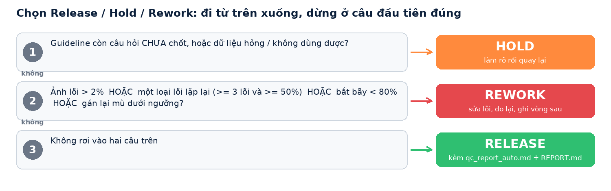

# Calibration và QC (Part 6)

Calibration = làm cho **bạn, máy và guideline** nhất quán, **có số đo và bằng chứng**. Part 6 gồm **ba bước làm theo thứ tự** (45 phút).
(Chọn ngưỡng theo lớp là việc của Part 3: xem [THRESHOLD.md](THRESHOLD.md).)

| Bước | Làm gì | Sản phẩm |
|---|---|---|
| 1. Calibration guideline (20') | mỗi ca mơ hồ một quyết định, viết vào v1.1 | `calibration_decisions.csv`, `guideline_v1.1_calibrated.md` |
| 2. QC (15') | kiểm mẫu 5 ảnh + ca khó | `qc_review.csv`, `qc_report_auto.md` |
| 3. Báo cáo và quyết định (10') | chọn Release / Hold / Rework, viết REPORT | `REPORT.md` |

(Gán lại mù để đo nhất quán của chính bạn: bài nâng cao, [ADVANCED.md](ADVANCED.md) mục 6.)

---

## Bước 1. Calibration guideline (~20 phút)

**Để làm gì:** biến lỗi và chỗ mơ hồ đã thấy thành **quy tắc viết ra giấy**, để lần sau không tranh luận lại.

**Gom ca từ các nguồn:**

| Nguồn (`nguon`) | Lấy ở đâu |
|---|---|
| `cau_hoi_mo` | 7 câu còn mở ở mục 6 của guideline v1.0 |
| `can_review` | các box bạn đã tick `can_review` |
| `loi_may` | lỗi lặp của máy: `deleted` / `added` cao ở một lớp; số "đổi lớp" trong `review_stats.md` |
| `bay_lot` | bẫy bạn để lọt (`review_stats.md` mục 3) |
| `self_check` | (nâng cao) `self_check_cases.csv` |

**Mỗi ca đã quyết = một dòng** trong `submission/qc/calibration_decisions.csv`:

```csv
case_id,image,nguon,van_de,quyet_dinh,quy_tac_ghi_vao_guideline,phien_ban_guideline
CAL-01,img_013|img_004,loi_may,"YOLO26 gọi tuk-tuk là car","luôn gán three_wheeler","mục 2: xe ba bánh có mui vẫn là three_wheeler",v1.1
```

- **Tối thiểu 3 dòng**, có ít nhất một ca `loi_may` và một ca `cau_hoi_mo`.
- Câu hỏi để lọc: **guideline mơ hồ** (cần sửa chữ) hay **bạn / máy làm sai** (không cần đổi guideline)? Chỉ trường hợp đầu mới vào v1.1.
- Quyết định nào là quy tắc mới phải **thật sự nằm** trong `guideline_v1.1_calibrated.md` (copy v1.0, sửa tại chỗ; khung: [guideline/TEMPLATE_v1.1.md](../guideline/TEMPLATE_v1.1.md)), kèm ảnh ví dụ.
- Quyết định làm đổi **nhãn đã gán** (ví dụ chuyển hẳn xe đạp điện sang `motorbike`)? Sửa trong CVAT, export `submission/labels/qc_fixed.json` (chỉ các ảnh đã sửa).

## Bước 2–3. QC, quyết định và báo cáo (~25 phút)

```bash
python scripts/build_release.py                       # nhãn cuối của 24 ảnh batch (có áp qc_fixed.json nếu có)
python scripts/qc_sample.py --n 5 --seed 42           # mẫu = tối đa 3 ảnh có can_review + 5 ảnh ngẫu nhiên
# mở work/qc/review/*.jpg (id từng vật in sẵn), điền submission/qc/qc_review.csv
python scripts/qc_report.py                           # thêm --guideline-gap N nếu còn câu hỏi chưa chốt
```

**Điền `qc_review.csv`:** mỗi lỗi một dòng (`image, object_id, error_type, reviewer, note`). Ảnh sạch ghi `error_type = khong`.
`error_type` chỉ nhận: `khong`, `bo_sot`, `thua`, `sai_lop`, `sai_vi_tri_kich_thuoc`, `sai_thuoc_tinh`, `sai_mask`. Lỗi bỏ sót không có id thì để trống `object_id`, ghi vào `note`. Dòng còn trống `error_type` = chưa kiểm.

**Chọn quyết định** (đi từ trên xuống, dừng ở câu đầu tiên đúng):



Rồi viết **`submission/REPORT.md` mục 7** (khuôn có sẵn). Hai điều **bắt buộc**:
1. **Mọi tỉ lệ kèm mẫu số** (ví dụ `1/8 ảnh = 12.5%`, không chỉ `12.5%`).
2. **Nói rõ giới hạn của mẫu nhỏ:** `qc_report_auto.md` có dòng "cận trên 95%". Với mẫu cỡ vài ảnh, ngưỡng 2% không thể được chứng minh.

> Chọn **Rework** trung thực **không bị trừ điểm**. Điều bị trừ là báo **Release** khi số liệu không đạt.
> Quyết định Rework: sửa lỗi, cập nhật nhãn (`qc_fixed.json`), chạy lại `build_release.py` và `qc_sample.py --force`, ghi vòng sau vào báo cáo.

---

# Đọc thêm (khi cần)

## A. Quy ước số đo (luôn ghi mẫu số)

| Chỉ số | Công thức | Ghi chú |
|---|---|---|
| Lỗi theo **đối tượng** | đối tượng lỗi / đối tượng trong mẫu | ví dụ `3/163 = 1.8%` |
| Lỗi theo **ảnh** | ảnh có ≥ 1 lỗi / ảnh trong mẫu | ngưỡng Release ≤ 2% |
| Accepted / edited / deleted | ÷ **box máy** | trạng thái của máy |
| Added | ÷ **đối tượng sau duyệt** | máy sót bao nhiêu (≈ 1 − recall) |
| Bắt bẫy | bẫy sửa đúng / tổng bẫy | ≥ 80% (≥ 10/12) |

**Hiểu từng số trong `review_stats.md`:**

| Thấy | Nghĩa là | Việc làm |
|---|---|---|
| `deleted` cao | ngưỡng quá thấp, hoặc ánh xạ nhãn sai | tăng ngưỡng lớp đó; kiểm `--map` / prompt |
| `added` cao | máy bỏ sót nhiều (ở lớp nào?) | hạ ngưỡng, thêm lượt tìm vật sót, đổi model |
| `accepted` thấp (< 50%) | sửa mỗi box lâu hơn vẽ mới | đổi model / ngưỡng; vẽ tay lớp đó |
| Recall của **máy** trên gold thấp | máy sót nhiều → `added` của batch sẽ cao | hạ ngưỡng, đổi model |
| Precision của **máy** trên gold thấp | nhiều box thừa → `deleted` cao | tăng ngưỡng |
| Bắt bẫy thấp dù `accepted` cao | bạn **không bắt lỗi của máy** (thiên kiến tự động hóa) | siết bước 0 của checklist |
| (nâng cao, có `gold_reviewed`) `residual` cao | bạn giữ lại lỗi của máy | xem bẫy lọt |


## B. Giới hạn thống kê của mẫu nhỏ

Nếu **0 lỗi** trong n ảnh, tỉ lệ ảnh lỗi thật vẫn có thể tới khoảng 3/n (quy tắc 3, độ tin cậy 95%): ví dụ 0/10 ảnh thì lỗi thật có thể tới ~30%.
`qc_report.py` in cận trên Wilson cho trường hợp bất kỳ. Vì vậy kết luận "đạt 2%" trên mẫu nhỏ là **yếu**; hãy viết rõ trong báo cáo.

## Script kiểm được gì, không kiểm được gì

Kiểm được: tên file, lớp có trong taxonomy, box trong ảnh, đủ ảnh được giao, accepted/edited/deleted/added, độ lệch giữa hai bộ nhãn, các số đo QC.
**Không** kiểm được: box có **ôm sát vật thật** không, lớp có đúng thực tế không, vật mà **cả bạn lẫn máy** cùng bỏ sót (ngoài gold), việc bạn có theo checklist thật hay không.
Những việc đó cần mắt người đối chiếu với guideline và ảnh gốc.
