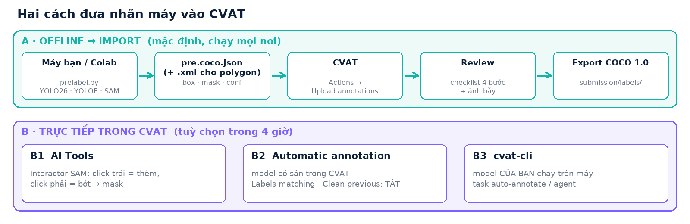
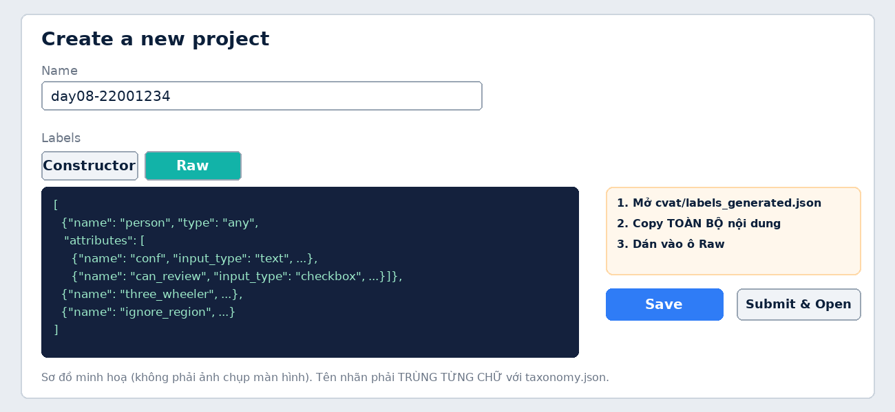
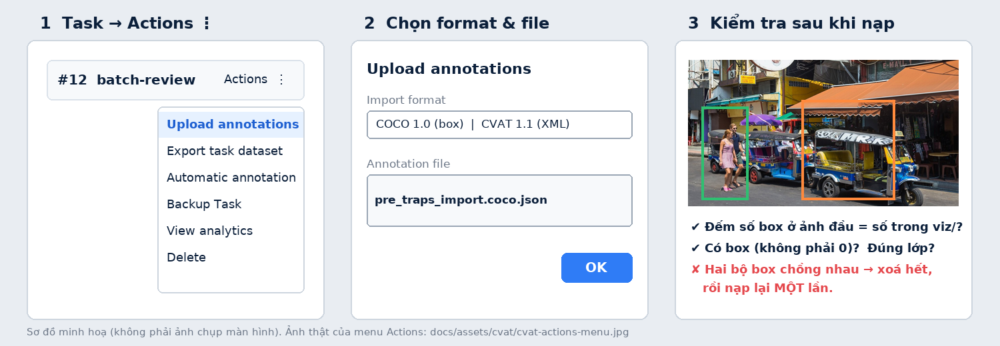
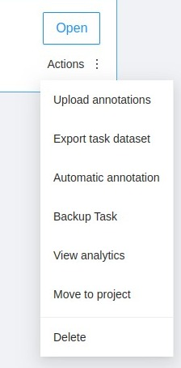
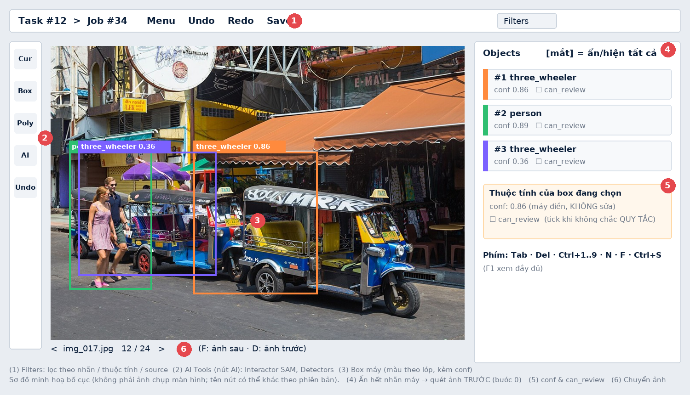
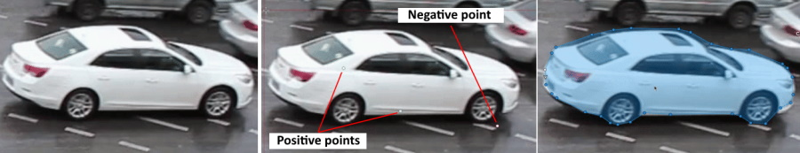
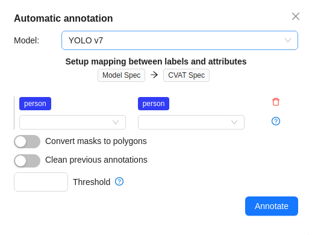

# Dùng pre-label với CVAT



Bản CVAT trong slide là **2.81**. Tên nút / menu giao diện dưới đây theo tài liệu CVAT 2.8x và có thể khác chút ở bản của bạn: nếu lệch, tra https://docs.cvat.ai và **ghi chú chỗ lệch vào `REPORT.md`** (đó là thông tin có giá trị). Lab này dùng **CVAT chạy bằng Docker trên máy bạn** (mục 0), **không** dùng bản web cvat.ai. Có **hai cách** đưa nhãn máy vào CVAT:

| Cách | Làm gì | Khi nào chọn | Chạy được ở đâu |
|---|---|---|---|
| **A. Offline → import** (mặc định của lab) | Chạy model bằng `scripts/prelabel.py` trên máy bạn → file COCO / XML → **Upload annotations** vào Task | luôn dùng được, kiểm soát được từng tham số, lặp lại được | CVAT Docker, mọi hệ điều hành |
| **B. Trực tiếp trong CVAT** | B1: công cụ **AI Tools** (Interactor SAM) bấm ngay trên ảnh • B2: **Automatic annotation** bằng model có sẵn trong CVAT • B3: model **của bạn** nối vào CVAT bằng `cvat-cli` | B1: vài vật khó cần mask • B2/B3: gán cả Task không cần file trung gian | B1/B2 cần serverless (Nuclio, mục 7); B3: CVAT Docker thường |

> **Bắt buộc:** Part 4 nạp nhãn bằng **cách A** (để có file `pre_traps` đo được). Cách B (trực tiếp trong CVAT) là **tuỳ chọn** trong 4 giờ: nếu có thời gian, thử B1 ở Part 5 hoặc B3 ở bài nâng cao.
> Nhớ: máy chỉ **đề xuất**; mọi cách đều phải đi qua checklist review ([REVIEW_CHECKLIST.md](REVIEW_CHECKLIST.md)).

---

## 0. Cài CVAT bằng Docker (làm trước buổi học)

CVAT chạy trong Docker trên máy bạn (khoảng 5–8 GB RAM khi chạy, ~6 GB ổ đĩa). Làm một lần.

**Bước 1. Cài Docker**

| Hệ điều hành | Cách cài |
|---|---|
| Windows | `winget install -e --id Docker.DockerDesktop`, khởi động lại máy, mở Docker Desktop, bật **Use WSL 2 based engine** (Settings → General) |
| Windows + WSL2 | Cài Docker Desktop như Windows; Settings → Resources → WSL Integration → bật cho bản Ubuntu của bạn. Rồi gõ lệnh `docker` ngay trong Ubuntu |
| macOS (chip Apple hoặc Intel) | `brew install --cask docker`, mở Docker Desktop một lần để nó cấp quyền |
| Ubuntu / Linux | `curl -fsSL https://get.docker.com \| sudo sh`, rồi `sudo usermod -aG docker $USER` và **đăng xuất / đăng nhập lại** |

Kiểm tra: `docker --version` và `docker compose version` đều in ra phiên bản.

**Bước 2. Chạy CVAT**

```bash
git clone https://github.com/cvat-ai/cvat
cd cvat
git checkout v2.81.0
docker compose up -d
docker exec -it cvat_server bash -ic 'python3 ~/manage.py createsuperuser'
```

Mở http://localhost:8080, đăng nhập bằng tài khoản vừa tạo. Lần đầu tải image mất 10–20 phút. Dừng khi không dùng: `docker compose down` (dữ liệu giữ trong volume); bật lại: `docker compose up -d`.

**Lưu ý theo máy**
- **RAM 8 GB:** CVAT + model cùng chạy sẽ thiếu bộ nhớ. Chạy model trên [Colab](COLAB.md), và chỉ bật CVAT khi đang gán / duyệt nhãn; đóng trình duyệt thừa. Giới hạn Docker Desktop ở khoảng 5 GB (Settings → Resources; Windows: file `.wslconfig`).
- **Mac chip Apple:** image CVAT là amd64 nên chạy qua giả lập (Docker Desktop báo cảnh báo platform): chạy được nhưng chậm hơn; mở Settings → General bật *Use Rosetta for x86/amd64 emulation* nếu có.
- **Windows:** nếu `docker compose up` báo lỗi virtualization, bật Virtualization trong BIOS và tính năng *Virtual Machine Platform*.
- Cổng 8080 bị chiếm? Tắt chương trình đang dùng cổng đó rồi chạy lại.

## 1. Project và nhãn (làm một lần)

```bash
python scripts/make_cvat_labels.py          # ghi cvat/labels_generated.json
```

1. CVAT → **Projects → Create new project**, tên `day08-<MSHV>`.
2. Mục **Labels** → tab **Raw** → dán toàn bộ `cvat/labels_generated.json` → **Save** (hoặc **Done** tuỳ phiên bản CVAT) → **Submit & Open**.
3. Kiểm tra: có đủ 8 nhãn (`person … three_wheeler`, `ignore_region`); mỗi nhãn (trừ `ignore_region`) có thuộc tính `conf` (text) và `can_review` (checkbox). Loại hình của nhãn là **Any** (vẽ được cả rectangle lẫn polygon).



Tên nhãn trong CVAT **phải trùng từng chữ** với `taxonomy.json` (script map theo tên).

## 2. Tạo Task

```bash
python scripts/prepare_workdirs.py
```

Sinh `work/tasks/{gold,review}/` (thêm `pilot`, `seg`, `selfcheck` nếu chạy `--advanced`). Mỗi thư mục là **một Task** (cùng Project):

| Task | Thư mục ảnh | Ảnh | Dùng ở |
|---|---|---|---|
| `gold-manual` | `work/tasks/gold/` | 4 | Part 1 (gán tay, **không AI**) |
| `batch-review` | `work/tasks/review/` | 24 (chỉ batch, **không** gồm gold) | Part 4 |
| `pilot` · `seg-review` · `selfcheck-blind` | `work/tasks/...` | 8 · 8 · 8 | chỉ [bài nâng cao](ADVANCED.md) |

**Create new task** → chọn Project → kéo cả thư mục ảnh vào → **Submit**. Đếm: số ảnh trong Task = số ghi ở bảng trên.

## 3. Cách A — Nạp nhãn máy vào Task

### 3a. Box (detection): COCO 1.0



Ảnh **thật** của menu *Actions* trong CVAT (từ tài liệu CVAT, giấy phép MIT):



1. Task → menu **Actions (⋮) → Upload annotations**.
2. **Import format: COCO 1.0** → chọn file `.json` (ví dụ `submission/prelabel/pre_traps_import.coco.json`) → **OK** (nếu `Import mode` đang để `Replace`, bấm thêm **Replace annotations** ở hộp thoại xác nhận). CVAT nhận được cả `.json` lẫn `.zip`.
3. Mở Task: đếm số box có trong ảnh đầu tiên và so với `viz/` bạn xem trước. Lệch nhiều = nhãn đang sai (xem mục 8).

### 3b. (Nâng cao) Mask nhiều ảnh: XML thay vì COCO

Nạp COCO có `segmentation` vào CVAT (theo mã nguồn CVAT 2.81) tạo **cả polygon lẫn rectangle** cho mỗi vật. Để chỉ có polygon:

```bash
python scripts/coco_to_cvat_xml.py --coco submission/prelabel/seg_pre.coco.json --shape polygon --out work/cvat_import/seg_pre.xml
```

Task → **Actions → Upload annotations → CVAT 1.1** → chọn `seg_pre.xml`.

### 3c. Điều cần biết sau khi nạp

- Mọi nhãn nạp từ file có `source = file` (không phải `auto`: `auto` chỉ do Automatic annotation / agent tạo). Dùng **Filters** (hoặc **Filter**) để lọc theo `source` hoặc theo nhãn.
- Thuộc tính `conf` là điểm của máy (chuỗi). Dùng để **xếp thứ tự duyệt** (xem 4), không thay việc nhìn ảnh.
- **Nạp lại**: tuỳ phiên bản CVAT, nạp lần hai có thể **ghi đè** hoặc **cộng thêm** nhãn. Luôn đếm số box sau khi nạp. Muốn chắc chắn: **Actions → Remove annotations** rồi nạp lại một lần.

## 4. Duyệt trong CVAT (phím tắt và mẹo)



Xem toàn bộ phím bằng **F1** trong job. Những phím dùng nhiều (keymap 2.81):

| Phím | Việc |
|---|---|
| `Tab` | sang box kế tiếp |
| `Del` | xoá box đang chọn |
| `Ctrl` + `1…9`, `0` | đổi nhãn của box đang chọn |
| `N` | lặp lại thao tác vẽ gần nhất (vẽ thêm box bị sót) |
| `F` / `D` | ảnh sau / ảnh trước |
| `Ctrl` + `S` | lưu (lưu thường xuyên) |

**Quét ảnh trước, rồi mới nhìn nhãn máy** (chống thiên kiến): dùng nút **ẩn / hiện tất cả đối tượng** (biểu tượng con mắt ở đầu danh sách *Objects*, tên nút có thể khác theo phiên bản). Cách làm từng ảnh: ẩn hết → bạn tự đếm vật trong ảnh → hiện nhãn máy → đối chiếu bốn bước ([REVIEW_CHECKLIST.md](REVIEW_CHECKLIST.md)).

**Thấy được box nào bạn chưa đụng tới / box nghi ngờ nhất:** dùng **Filters** (hoặc **Filter**) theo `source` (`file` = nhãn máy nạp vào, `manual` = bạn vẽ) và theo thuộc tính `conf`.
Với box máy bạn sửa trong CVAT, `source` có thể đổi, nên **không dùng `source` thay cho việc so file**: `review_stats.py` mới là nơi tính accepted / edited / deleted / added.

## 5. Export nhãn sau duyệt

1. Task → **Actions → Export task dataset**.
2. **Format: COCO 1.0**, **Save images: tắt**, OK.
3. Tải file `.zip` ở trang **Requests**, giải nén, lấy `annotations/instances_default.json`, đổi tên đúng bảng dưới và đặt vào `submission/labels/`.

| Task | Tên file nộp |
|---|---|
| gold-manual | `gold_manual.json` |
| batch-review | `batch_reviewed.json` |
| (nâng cao) pilot / seg-review | `pilot_reviewed.json` / `seg_reviewed.json` |

`python scripts/validate_labels.py --all` rồi mới tiếp tục.

---

## 6. Cách B — Dùng AI trực tiếp trong CVAT

### B1. Interactor (SAM): click ra mask



*Ảnh từ tài liệu CVAT (MIT).*

Trong job: thanh công cụ trái → **AI Tools** → tab **Interactors** → chọn model **Segment Anything** (SAM / SAM 2 tuỳ máy chủ) → chọn nhãn → click **trái** vào vật (dương), **phải** vào vùng thừa (âm) → `N` kết thúc, mask thành polygon.
Menu **Models** (thanh trên cùng) phải có tên model; không thấy nghĩa là máy chủ chưa cài.

Hạn chế: CVAT Docker mặc định **chưa** cài model AI (cần serverless, mục 7).
Không dùng được B1? Thay bằng `scripts/sam2_points.py` (Part 5) cho phần "hiểu", và box → mask bằng SAM trong `prelabel.py --segmenter sam --sam <phiên bản>` cho phần "làm".

### B2. Automatic annotation (model có sẵn trong CVAT)



*Ba ô cần điền: **Model**, **Labels matching** (Model Spec → CVAT Spec; sai thì sai cả lô), **Clean previous annotations** (để **tắt**: bật sẽ xoá nhãn bạn đã vẽ). Ô *Threshold* có hay không tuỳ model. Ảnh từ tài liệu CVAT (MIT).*

Task trong danh sách → **⋮ → Automatic annotation** → chọn **Model** → **Labels matching** (nhãn của model → nhãn Project) → **Clean previous annotations** (**tắt**: bật sẽ xoá nhãn bạn đã vẽ) → **Annotate**.
- Chạy thử trên Task mẫu nhỏ trước khi chạy cả lô. Kiểm 5 ảnh đầu: ánh xạ sai thì sai cả lô.
- Kết quả có `source = auto`: lọc theo `source = auto` để ra danh sách phải duyệt đầu tiên.

### B3. Model CỦA BẠN chạy trong CVAT (`cvat-cli`)

*(Cờ và lệnh dưới đây đã đối chiếu với `cvat-cli --help` bản 2.83; chưa thử trên mọi máy. Có thể dùng Personal Access Token qua `CVAT_ACCESS_TOKEN` thay mật khẩu.)*

Cách này **không cần máy chủ CVAT có GPU hay serverless**: model chạy trên máy bạn, CVAT chỉ nhận kết quả. Dùng được với CVAT Docker trên mọi hệ điều hành, cả Mac.

```bash
pip install -r requirements-cvat.txt
```

**(a) Chạy một lần trên một Task đã có** — hàm [scripts/cvat_function_yolo26.py](../scripts/cvat_function_yolo26.py) (YOLO26; 6 lớp COCO):

```bash
# CVAT Docker trên máy bạn (cổng 8080)
cvat-cli --server-host http://localhost --server-port 8080 --auth <tên-đăng-nhập> \
    task auto-annotate <TASK_ID> --function-file scripts/cvat_function_yolo26.py \
    -p size=str:m -p seg=bool:false --conf-threshold 0.3

```

`<TASK_ID>` là số trong URL của Task (`/tasks/<ID>`). Mật khẩu: `cvat-cli` hỏi khi chạy, hoặc biến môi trường `PASS`; có thể dùng Personal Access Token qua `CVAT_ACCESS_TOKEN` (không ghi vào file trong repo).
Thêm `--clear-existing` chỉ khi bạn muốn **xoá** nhãn cũ của Task.

**(b) Đăng ký thành "model" và bấm trên giao diện** (agent):

```bash
cvat-cli ... function create-native "YOLO26 lab" --function-file scripts/cvat_function_yolo26.py -p size=str:m
cvat-cli ... function run-agent <FUNCTION_ID> --function-file scripts/cvat_function_yolo26.py -p size=str:m
```

Giữ terminal chạy (agent). Trên CVAT: **Automatic annotation** sẽ thấy "YOLO26 lab" trong danh sách Models.

Giới hạn của hàm mẫu: chỉ 6 lớp COCO, **không** có `three_wheeler` (cần model open-vocab). Muốn mở rộng: copy file, thêm YOLOE (xem `prelabel.py`), nhớ khai báo lớp mới trong `spec`.
Đây là phần **tuỳ chọn nâng cao**: tham khảo [tài liệu auto-annotation của CVAT](https://docs.cvat.ai/docs/api_sdk/sdk/auto-annotation/).

---

## 7. Model AI trong CVAT Docker (nâng cao)

Cài CVAT: mục 0. Model AI trong CVAT Docker (B1/B2) cần thêm **serverless (Nuclio)**: xem hướng dẫn chính thức
https://docs.cvat.ai/docs/administration/advanced/installation_automatic_annotation/ (cài `nuctl`, chạy compose có `docker-compose.serverless.yml`, deploy từng model từ thư mục `serverless/`).
Trên **Mac Apple Silicon** các image Nuclio thường là amd64 và rất chậm hoặc lỗi: dùng cách A và B3.

## 8. Gỡ rối

| Triệu chứng | Nguyên nhân thường gặp → cách xử lý |
|---|---|
| Nạp xong **không thấy box** | Tên ảnh trong Task khác tên trong file (CVAT khớp theo tên file). Task phải tạo từ **đúng** thư mục `work/tasks/...`. |
| Nạp COCO báo lỗi "label ... not found" | Project còn bộ nhãn cũ → tạo lại Project từ `cvat/labels_generated.json` |
| Hai bộ box chồng nhau | Nạp hai lần (CVAT cộng thêm) → **Actions → Remove annotations**, nạp lại một lần |
| Mỗi vật có cả rectangle lẫn polygon (task seg) | Nạp COCO thay vì XML → xoá annotation, làm lại bằng `coco_to_cvat_xml.py` |
| Thuộc tính trống sau export | Mở một box, chọn lại thuộc tính, lưu rồi export lại; hoặc đặt `default_value` ở Project |
| `validate_labels.py` báo "lớp lạ '?category_id=…'" | Xuất nhầm format (không phải COCO 1.0) |
| Export báo lỗi | Đợi vài giây, tải lại ở trang **Requests** |
| `cvat-cli`: lỗi xác thực | Sai `--server-host`/`--server-port` (CVAT Docker: `http://localhost` + `8080`) hoặc sai mật khẩu |
| `cvat-cli` báo nhãn không khớp | Hàm khai báo nhãn trùng **tên** với nhãn Project; kiểm tra bước 1 |
| Automatic annotation không có model | Máy chủ chưa cài model (mục 7) → dùng B3 |

---

*Nguồn ảnh:* các ảnh trong `assets/cvat/` lấy từ tài liệu CVAT (https://docs.cvat.ai, repo cvat-ai/cvat, giấy phép MIT). Các sơ đồ còn lại (`two_paths`, `cvat_project_labels`, `cvat_upload_flow`, `cvat_job_ui`) do giảng viên vẽ bằng `assets/make_figures.py`, **không phải ảnh chụp màn hình**: tên nút / vị trí có thể khác theo phiên bản CVAT.
