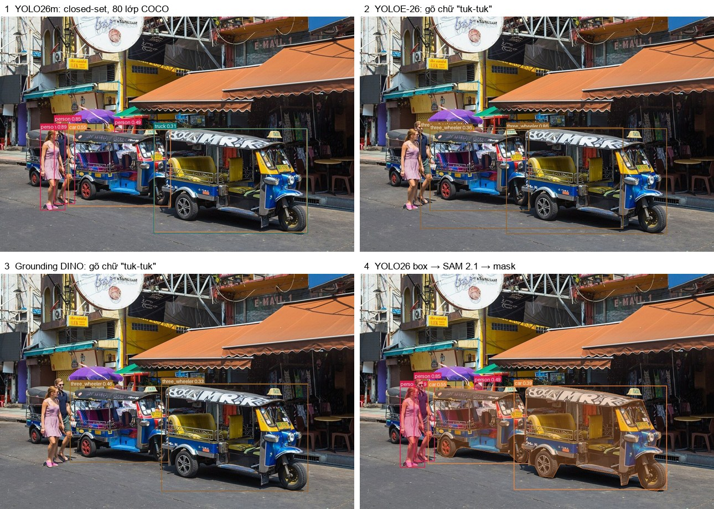
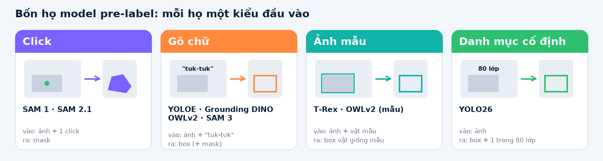
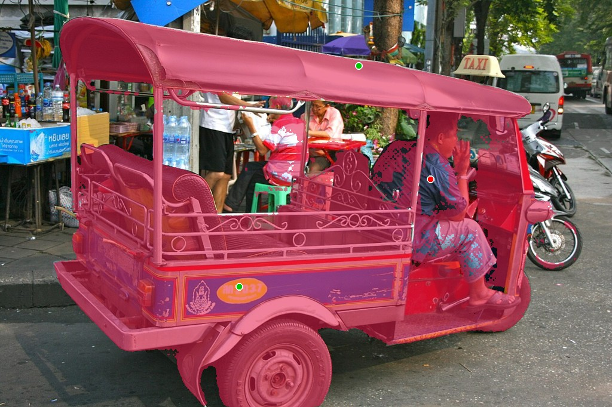

# Tour model (Part 2): YOLO26 · SAM · YOLOE

Đi **từ đơn giản đến phức tạp** bằng **ba model bắt buộc**. Mỗi mục: model là gì → lệnh chạy → **nhìn gì** → ghi vào `submission/model_log.csv`.
Chạy ở thư mục gốc repo, venv đã kích hoạt ([SETUP.md](SETUP.md)). Ảnh kết quả ở `work/prelabel/<tên>/viz/`. Model nặng hơn (Grounding DINO, OWLv2, SAM 3): [ADVANCED.md](ADVANCED.md).



*Cùng ảnh `img_017`: (1) YOLO26 gọi tuk-tuk là `car`/`truck`, (2) YOLOE gõ chữ tìm được tuk-tuk nhưng box lỏng, (3) Grounding DINO (nâng cao), (4) SAM biến box thành mask (mask chỉ đúng khi box đúng).*



## Ba model bắt buộc

| # | Model | Đầu vào | Đầu ra | Điểm yếu cần kiểm |
|---|---|---|---|---|
| A | **YOLO26** | ảnh | box + 1 trong 80 lớp COCO | không biết lớp mới (tuk-tuk → car/truck), vật nhỏ ở xa |
| B | **SAM** (chọn SAM 1 hoặc 2.1; SAM 3 ở nâng cao) | ảnh + click / box | mask | một click mơ hồ (vật hay bộ phận?); box sai thì mask sai |
| C | **YOLOE-26** | ảnh + chữ | box (+ mask) | gọi nhầm lớp, box lỏng, chữ khác cho kết quả khác |

`model_log.csv`: mỗi lần chạy một dòng `run_id, part, model, params, split, n_boxes, sec_per_img, what_went_right, what_went_wrong, decision`.
`prelabel.py` tự ghi dòng có sẵn các cột đó vào `work/runs.csv` (cột `model` ghi cả SAM đã dùng, ví dụ `yolo26-m+sam(sam2.1_b.pt)`) (`part`, nhận xét để trống): copy sang `model_log.csv` rồi điền bằng **mắt nhìn ảnh**. Nhận xét phải **cụ thể** (ảnh nào, vật nào), không viết "kém".

> **Luôn đọc dòng cuối của lệnh**: `Tên thô KHÔNG có trong ánh xạ ...` là các lớp COCO (bottle, umbrella...) bị bỏ vì không có trong taxonomy: đó chính là hộp thoại *Labels matching* của CVAT, ánh xạ thiếu = mất box im lặng.

---

## A. YOLO26 — detector đóng (closed-set)

**Là gì.** Detector thời gian thực của Ultralytics, huấn luyện sẵn trên 80 lớp COCO. Chỉ nói được những lớp trong danh sách đó.
Cỡ model: `n` (nhỏ, nhanh) … `x` (lớn, chậm). Lab dùng `m`.

```bash
# ngưỡng thường dùng (0.25) và ngưỡng cao (0.5): sạch hơn nhưng sót
python scripts/prelabel.py --model yolo26 --size m --split pilot --conf 0.25 --out work/prelabel/t_y26
python scripts/prelabel.py --model yolo26 --size m --split pilot --conf 0.5  --out work/prelabel/t_y26_c05
```

**Nhìn gì.** So `viz/` của hai lần chạy trên `img_011` và `img_016`:
- Số box đổi thế nào theo ngưỡng (xem dòng "Số box theo lớp")? Ngưỡng nào bạn bắt đầu thấy xe bị bỏ sót? Ngưỡng nào còn nhiều box thừa?
- **Tuk-tuk / ba gác** được gọi là gì? (gợi ý: thường `car` hoặc `truck`). Đây là lý do cần model open-vocab (mục C).
- Người ngồi trên xe máy: có box `person` riêng không? Có box `motorbike` riêng không?
- Có lớp nào bị bỏ vì không ánh xạ không (`banana`, `umbrella`...)? Bỏ như vậy có đúng với taxonomy không?

**Ghi `model_log`:** hai dòng (hai ngưỡng), `what_went_wrong` ghi lỗi **cụ thể** (ảnh, vật), không ghi "kém".

---

## B. SAM — Segment Anything: từ prompt ra mask (**BẮT BUỘC**)

**Là gì.** Model "phân đoạn mọi thứ" của Meta. Bạn đưa **prompt hình học** (click dương / âm, hoặc box) và nó trả mask. Không biết tên lớp.
Trong CVAT đây là công cụ **Interactor** (click trái = thêm, click phải = bớt).

### B0. Chọn phiên bản SAM (bắt buộc dùng ít nhất một)

| Phiên bản | Trọng số | Cỡ | Prompt | Chạy bằng | Hợp khi |
|---|---|---|---|---|---|
| **SAM 1** (2023) | `mobile_sam.pt` (bản nhẹ) · `sam_b.pt` · `sam_l.pt` | 40 MB · 375 MB · 1.2 GB | click, box | `--sam mobile_sam.pt` | máy yếu, chỉ cần mask cho ảnh tĩnh |
| **SAM 2.1** (2024) | `sam2.1_t/s/b/l.pt` | 40–900 MB | click, box (+ video) | `--sam sam2.1_b.pt` (**mặc định**) | cân bằng chất lượng / tốc độ; khuyến nghị |
| **SAM 3** (2025, gated) | `facebook/sam3` | ~3.5 GB | **chữ** (mọi instance) | `--model sam3` ([ADVANCED.md](ADVANCED.md)) | có GPU, có quyền truy cập, muốn mask hàng loạt từ chữ |

- **Bạn chọn một phiên bản chính** cho Part 5 và ghi **vì sao** vào `REPORT.md` mục 1 (chất lượng mask, tốc độ, RAM, giấy phép, có cần quyền không).
- `model_log.csv` phải có **ít nhất một dòng chạy SAM** ghi rõ phiên bản (tự kiểm tra bằng `check_submission.py`). Khuyến khích so **hai phiên bản** (ví dụ `mobile_sam.pt` và `sam2.1_b.pt`) trên cùng 3 vật và ghi biên mask khác nhau thế nào.
- Chưa có quyền SAM 3? Chọn SAM 1 hoặc 2.1: vẫn **đủ yêu cầu**. Dùng SAM 3 được tính là đã dùng SAM.
- Tải: `python scripts/download_models.py --set sam1` (mobile_sam) · `--set sam1-base` · `--set sam2` · `--set sam3`.

### B1. Prompt bằng click (mô phỏng Interactor)

```bash
# một click vào huy hiệu vàng trên thân xe: mask rất nhỏ (chỉ cái huy hiệu)
python scripts/sam2_points.py --image img_013.jpg --pos "400,480" --out work/sam2_a   # thêm --sam mobile_sam.pt để thử SAM 1
# thêm click lên mui xe: mask phủ cả xe
python scripts/sam2_points.py --image img_013.jpg --pos "400,480" --pos "600,110" --out work/sam2_b
# thêm click ÂM lên người lái, thử 1 rồi 2-3 click
python scripts/sam2_points.py --image img_013.jpg --pos "400,480" --pos "600,110" --neg "720,300" --out work/sam2_c
```



*Chấm xanh = click dương, chấm đỏ = click âm. Mask phủ cả xe **kèm người lái**.*

**Nhìn gì.**
- Một click cho mask là **bộ phận, vật, hay cả nhóm**? Slide gọi đó là "một click, ba mask hợp lệ": **label contract quyết định, không phải model**.
- Guideline v1.0 nói người là `person` riêng, xe là `three_wheeler` riêng: mask của xe có gồm người lái không? Cần bao nhiêu click âm để loại?
- Số polygon của mask (dòng in ra): vật rời rạc (do bị che) cho nhiều polygon. Guideline nói gì?

### B2. Box → mask (kiểu "detector rồi segmenter"; đổi `--sam` để chọn phiên bản)

```bash
python scripts/prelabel.py --model yolo26 --size m --classes "person,motorbike,car" --images img_004.jpg img_013.jpg \
    --conf 0.3 --segmenter sam --sam sam2.1_b.pt --out work/prelabel/y26_sam2   # đổi --sam để so phiên bản
```

**Nhìn gì.** Mask đúng khi box đúng. Box sai (ví dụ `car` bao cả tuk-tuk) thì mask tô **cả tuk-tuk** và vẫn mang nhãn sai: **sai lớp không phải do mask**.
So biên mask giữa hai phiên bản SAM (ví dụ `mobile_sam.pt` và `sam2.1_b.pt`, nếu bạn thử cả hai): cái nào bám sát hơn? Cái nào sót / thừa phần nào?
Lỗi lan truyền: nếu box thừa (không có vật) thì mask là gì? (gợi ý: thử một ảnh có `chair` hoặc `umbrella` bị gán nhầm.)

---

---

## C. YOLOE-26 — open-vocabulary, gõ chữ ra box + mask

**Là gì.** Biến thể YOLO nhận **danh sách chữ** thay vì 80 lớp cố định ("zero-shot": chưa huấn luyện riêng cho lớp đó), vẫn chạy rất nhanh.
Lệnh dùng `--prompts 'cụm chữ=lớp'` để nối chữ với lớp trong taxonomy. `--classes three_wheeler` để chỉ giữ lớp đó.

```bash
# prompt mặc định lấy từ taxonomy.json: tuk-tuk, cyclo, cargo tricycle -> three_wheeler
python scripts/prelabel.py --model yoloe --classes three_wheeler --split pilot --conf 0.25 --out work/prelabel/yoloe_pilot
# thử CHỮ KHÁC: một khái niệm một prompt
python scripts/prelabel.py --model yoloe --prompts "three-wheeled vehicle=three_wheeler" --classes three_wheeler \
    --split pilot --conf 0.25 --out work/prelabel/yoloe_pilot_v2
# prompt bẫy (hard negative): thêm "motorbike" để thấy nó có giành lấy xe ba bánh không
python scripts/prelabel.py --model yoloe --prompts "tuk-tuk=three_wheeler,motorbike=motorbike,car=car" \
    --split pilot --conf 0.25 --out work/prelabel/yoloe_pilot_v3
```

**Nhìn gì.**
- Tuk-tuk, xích lô, ba gác: model tìm được loại nào, bỏ sót loại nào? (Xích lô và xe ba gác thường khó hơn tuk-tuk.)
- Đổi chữ prompt: số box và độ chính xác đổi thế nào? Có chữ nào cho kết quả tốt hơn rõ rệt?
- Prompt "motorbike=motorbike": box xe ba bánh có bị đổi nhãn thành motorbike không?
- Box có **lỏng** (rộng hơn vật) không? Box có phủ cả người ngồi / vật phía sau không?

**Cạm bẫy (slide, 4 luật viết prompt):** một khái niệm một prompt; attribute ≠ vật; viết rõ hard negative; ngưỡng **theo từng lớp**.

---

---

## Sau khi thử (cuối Part 2)

Chạy mọi ảnh một lần ở ngưỡng thấp (nguồn cho Part 3, 4):

```bash
python scripts/prelabel.py --model yolo26 --size m --split all --conf 0.05 --out work/prelabel/y26_all --no-viz
python scripts/prelabel.py --model yoloe --classes three_wheeler --split all --conf 0.05 --out work/prelabel/yoloe_all --no-viz
```

**Vì sao ghép hai model:** YOLO26 giỏi 6 lớp COCO nhưng mù tuk-tuk; YOLOE biết tuk-tuk nhưng kém 6 lớp kia. `merge_prelabels.py` (Part 3, 4) cho `three_wheeler` của YOLOE thắng `car`/`truck` của YOLO26 khi chúng chồng nhau (IoU ≥ 0.6).

**Ba câu hỏi để ghi vào `REPORT.md` mục 1:**
1. Với từng lớp, model nào bạn dùng và vì sao (dẫn dòng `model_log`)?
2. Lỗi nào của máy **không thể sửa bằng đổi ngưỡng** (gợi ý: tuk-tuk bị gọi `car`)? Sửa bằng cách nào?
3. Slide nói *"điểm tin cậy không bảo đảm nhãn đúng"*: bạn đã thấy box điểm cao mà sai (hoặc điểm thấp mà đúng) ở ảnh nào?
